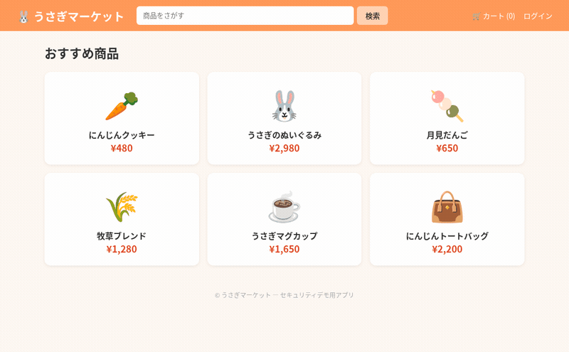
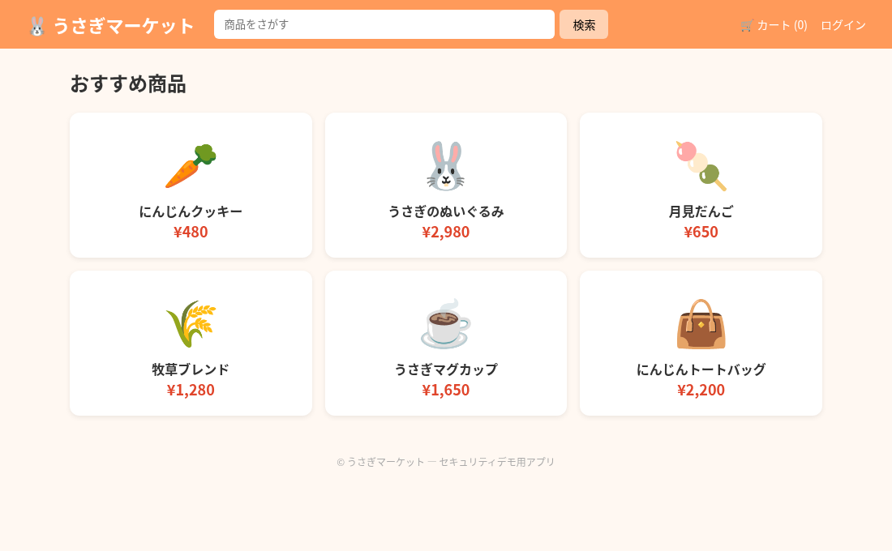
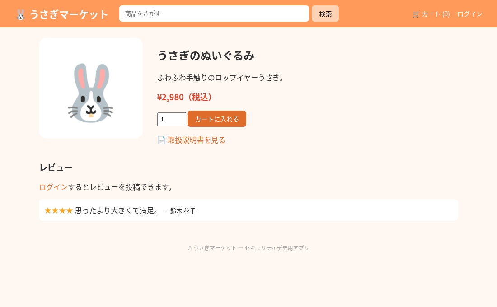
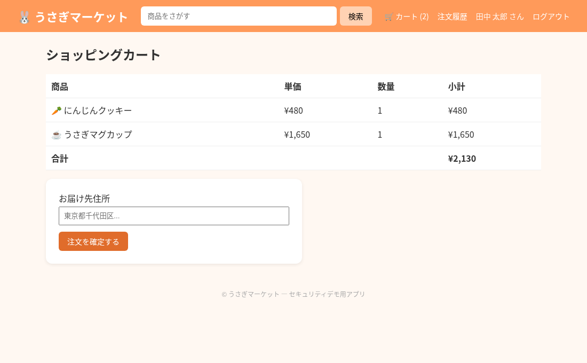
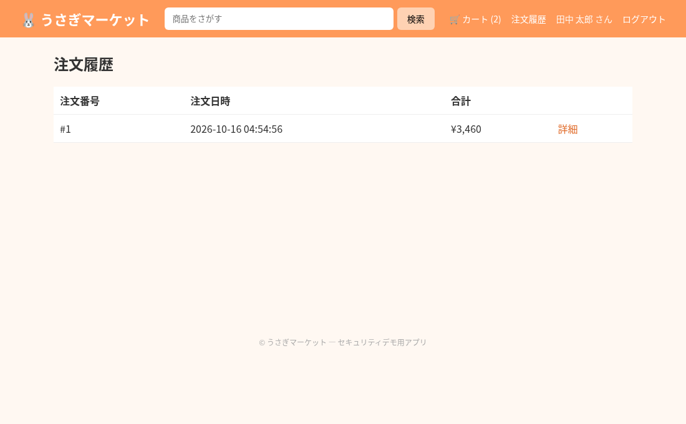
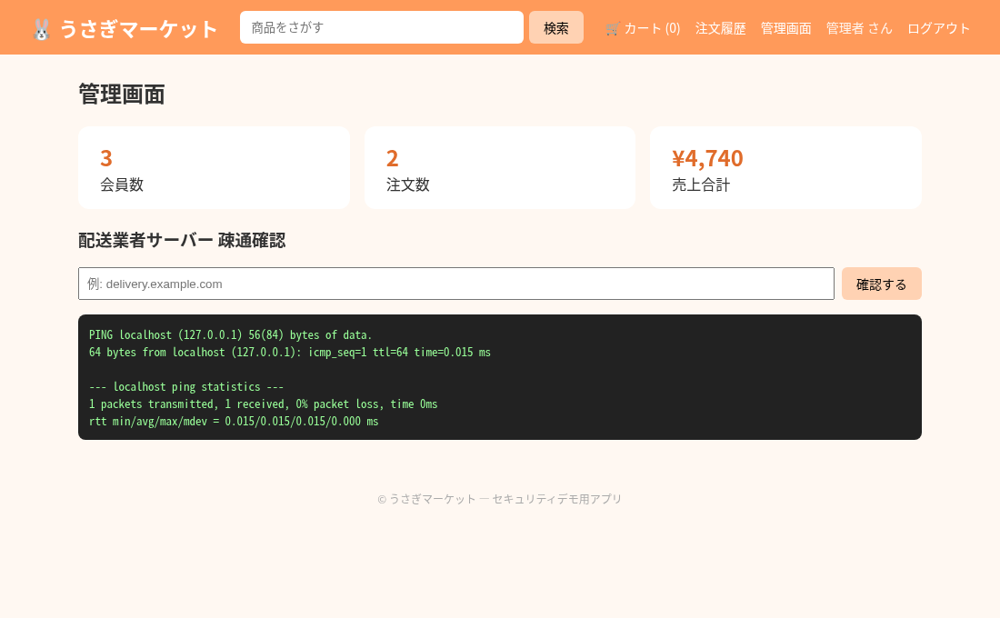

# 🐰 うさぎマーケット（usagi-ecommerce）

うさぎグッズを販売する、小さな EC サイトです。商品の検索・閲覧、レビュー投稿、カート、注文、注文履歴、管理画面（売上集計）といった EC の基本機能をシンプルな構成で実装しています。



> ⚠️ **注意：このアプリはセキュリティ診断（コードスキャン）のデモ用です。**
> 学習・デモ目的で **意図的に脆弱性を含んでいます**。本番環境やインターネットに公開された環境では絶対に動かさないでください。

## 画面

| 商品一覧 | 商品詳細・レビュー |
|---|---|
|  |  |

| カート | 注文履歴 | 管理画面 |
|---|---|---|
|  |  |  |

## 主な機能

- 商品一覧・キーワード検索
- 商品詳細、取扱説明書の表示、レビュー投稿
- カート（Cookie 保存）と注文確定
- 注文履歴・注文詳細
- 管理画面（会員数・注文数・売上合計、配送業者サーバーの疎通確認）

## 技術構成

| 項目 | 内容 |
|---|---|
| 言語 | Python 3.12 |
| フレームワーク | Flask 2.2 / Jinja2 |
| DB | SQLite（初回起動時に `schema.sql` とサンプルデータで自動作成） |
| テスト | pytest（GitHub Actions で実行） |

```
app.py              # アプリ本体（ルーティング・DB アクセス）
schema.sql          # テーブル定義
templates/          # 画面テンプレート
static/             # CSS・取扱説明書ファイル
tests/              # pytest
```

## 起動方法

```bash
python3 -m venv .venv
source .venv/bin/activate
pip install -r requirements-dev.txt
python app.py
```

ブラウザで http://localhost:5000 を開きます。DB をリセットしたい場合は `usagi.db` を削除して再起動してください。

### デモ用アカウント

| ユーザー名 | パスワード | 権限 |
|---|---|---|
| tanaka | password | 一般会員 |
| suzuki | usagi2024 | 一般会員 |
| admin | admin123 | 管理者 |

## テスト

```bash
pytest -q
```
